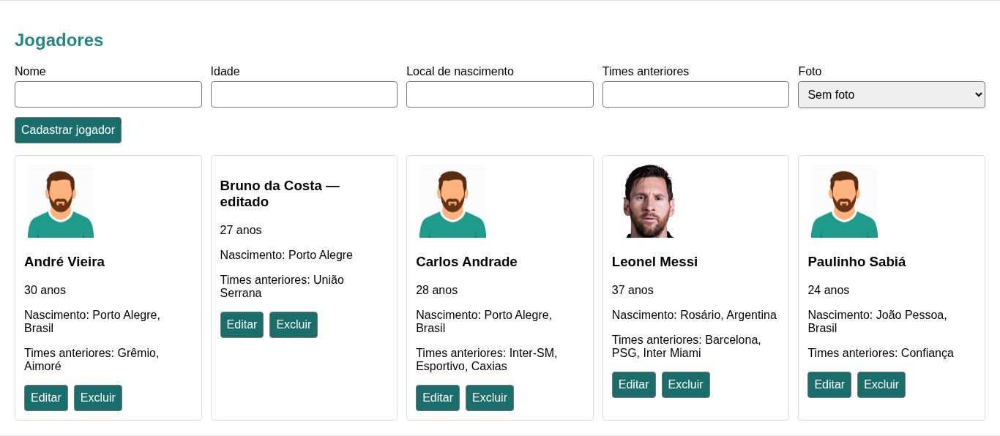
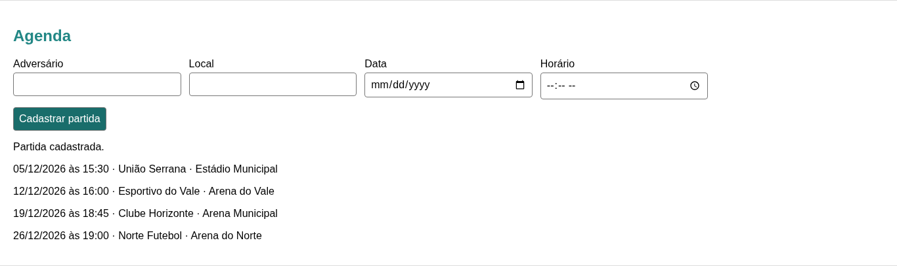

# Relatório técnico · Sistema Web de Gestão Esportiva Atlético RS

| Identificação | Informação |
| --- | --- |
| Versão | 1.0.0 (MVP) |
| Data da validação | 24 de novembro de 2026 |
| Projeto original | Renan Silva Nogueira |
| Código-fonte | [renansnog/atletico_rs](https://github.com/renansnog/atletico_rs) |
| Base da evolução | [Commit 18f5ea6](https://github.com/renansnog/atletico_rs/commit/18f5ea6b6dad65561c4cf9369e0cb4e6ddd99afd) |

O software centraliza registros do elenco e dos jogos de um clube de futebol e apresenta os cargos e integrantes da diretoria. A interface HTML, CSS e JavaScript envia requisições HTTP à API Flask. O backend valida os campos e grava os dados no MySQL por meio do MySQL Connector/Python. As consultas recuperam os registros persistidos e alimentam as listas na página.

## Contribuições anteriores e auxílio de IA

| Trabalho anterior de Renan Silva Nogueira, conforme o histórico | Trabalho para a versão 1.0.0, realizado com auxílio do Codex |
| --- | --- |
| Página institucional, menu, seções, identidade visual e arquivos de imagem | Correção dos caminhos dos arquivos estáticos, do carregamento das listas e do link para a diretoria. Inclusão dos formulários e controles de gestão |
| Esquema SQL das tabelas e exemplos iniciais de jogadores | Esquema reaplicável, dados opcionais de demonstração para partidas e diretoria e manutenção das tabelas existentes |
| Aplicação Flask e rotas de consulta de jogadores, agenda e diretoria | CRUD de jogadores, cadastro de partidas, validação, persistência, respostas de erro e formatação de data e hora |
| README inicial com instruções de execução | Configuração por ambiente, revisão das instruções, execução de testes e registro de evidências |

## Diagnóstico da base

- O registro do evento inicial continha erro de sintaxe em JavaScript. A página deixava de executar as três consultas.
- Os caminhos de CSS, JavaScript e fotos não correspondiam às URLs estáticas do Flask. A origem da foto também concatenava um arquivo fixo com o valor do banco.
- O link administrativo apontava para uma rota inexistente. A seção de diretoria já existia na página.
- O Flask oferecia somente leitura. A agenda retornava valores MySQL de data e hora sem convertê-los para um formato estável no JSON.
- A configuração do MySQL estava fixa no código. O arquivo `.env` estava vazio e versionado, e o arquivo de dependências tinha um erro no nome.

## Escopo implementado

- **Jogadores.** Cadastro com nome, idade, local de nascimento, clubes anteriores e foto opcional da galeria. Listagem na tela, consulta por ID na API, edição e exclusão com confirmação.
- **Partidas.** Cadastro de adversário, local, data e horário. Consulta ordenada por data e horário e apresentação da data no formato brasileiro.
- **Diretoria.** Consulta de nomes e cargos, com acesso pelo menu.
- **Execução local.** Configuração do MySQL em `.env`, scripts separados para o esquema e a demonstração e instruções para Windows. Os dados de teste descrevem um cenário de demonstração.

## Validação

A aplicação foi executada em Linux com Python 3.12.14, Flask 3.1.3, MySQL Connector/Python 9.7.0 e MySQL Community Server 8.4.13. Os testes enviaram requisições HTTP ao servidor Flask em execução, conectado a uma instância MySQL isolada. O esquema foi aplicado novamente após a carga inicial e manteve os quatro registros de jogadores.

| Cenário | Resultado observado |
| --- | --- |
| Página inicial, CSS, JavaScript e imagem original | HTTP 200 |
| Criar, listar e consultar jogador por ID | HTTP 201 no cadastro. A consulta recuperou nome com acento e apóstrofo, idade e demais dados |
| Editar e repetir a edição | HTTP 204 nas duas gravações. Uma nova consulta recuperou a idade alterada |
| Excluir e consultar o registro excluído | HTTP 204 na exclusão e HTTP 404 na consulta posterior e na repetição da exclusão |
| Consultar com `HEAD` | HTTP 200 nas rotas de leitura verificadas, com registros preservados |
| Cadastrar e consultar partida | HTTP 201 seguido de consulta com adversário, local, data e hora gravados |
| Consultar diretoria | A API retornou integrantes e cargos do banco |
| Enviar nome vazio, idade booleana e data inexistente | HTTP 400, com as contagens de registros preservadas |

### Testes no navegador

O Chromium Headless 156, controlado pelo Playwright, abriu a aplicação em execução e carregou as imagens originais. Foram testados o cadastro de um jogador, a edição com preenchimento do formulário, a persistência após recarregar a página, o cancelamento e a confirmação da exclusão, e a resposta HTTP 404 após excluir. Também foram confirmados o cadastro de uma partida, a exibição da data e hora, a persistência após recarregar e a navegação pelo menu para a diretoria. O teste terminou sem erros JavaScript.

### Capturas da aplicação em execução

**Elenco.** O registro “Bruno da Costa — editado” aparece após salvar a edição e recarregar a página.

**Agenda.** A interface confirma o cadastro e lista a partida contra o Clube Horizonte em 19/12/2026 às 18:45.

**Diretoria.** A seção mostra os integrantes e cargos consultados no banco de demonstração.

## Limites da validação

O teste foi feito em Linux com um banco isolado. O README inclui os comandos para Windows, plataforma em que a aplicação ainda não foi executada. A gestão funciona em ambiente local e sem autenticação de usuários da interface.
